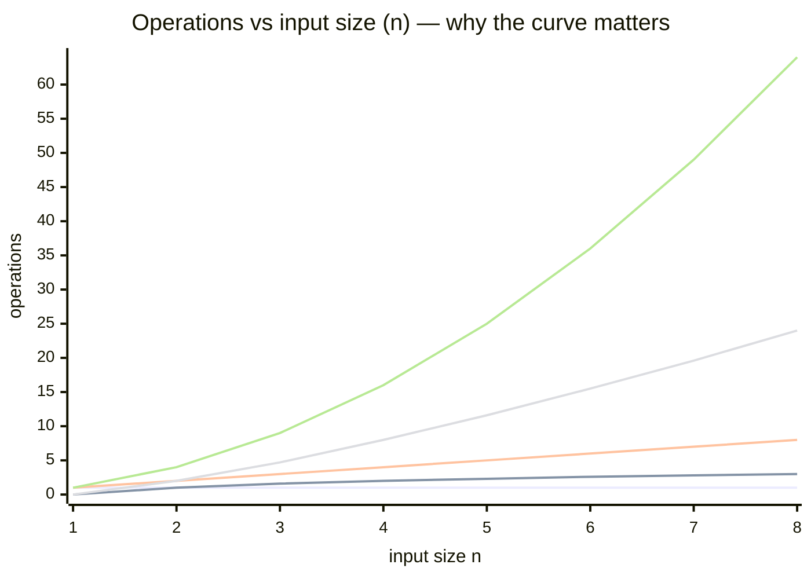

<div align="center">


<br>


<br>


</div>

---

## 📌 What is this?

A disciplined, public grind through the [**LeetCode Top Interview 150**](https://leetcode.com/studyplan/top-interview-150/) — the curated set every FAANG-prep guide points to. The twist: **every problem is solved in 9 languages**, so each folder becomes a side-by-side study of how the same algorithm reads across the ecosystem.

One problem. Nine implementations. Committed every day.

---

## 🎯 The Target

| Goal | Target | Why |
|------|--------|-----|
| 🧩 **Solve all 150** | `150 / 150` | Full interview-pattern coverage across 23 topic groups |
| 🌐 **9 languages each** | `1350` solutions | Fluency, not familiarity — see the algorithm, not the syntax |
| 📅 **Daily cadence** | `1+ / day` | Consistency beats intensity. Ship something every day |
| 📊 **Balanced GitHub activity** | `~25% each` | Commits · PRs · Issues · Code review — healthy, not commit-only |

> **On the activity split:** GitHub's profile radar shows *shares of total activity* that always sum to 100%, so "all four above 30%" is mathematically impossible. The real target is **balance** — using branches, PRs, and issues per problem instead of raw commits to main.

---

## 📈 Progress

```text
Overall  [□□□□□□□□□□□□□□□□□□□□]   0 / 150   (0.0%)
```

<div align="center">


<br><br>


</div>

---

## 📊 GitHub Activity

These cards update automatically as you commit — the streak counter is your daily accountability meter.

<div align="center">


<br><br>


<br><br>


</div>

---

## 🧠 Big-O — Why Complexity Matters

Every solution here is tagged with its **time** and **space** complexity. That number decides whether code *passes* or *times out* — here's the shape of the problem:



> **Flattest → steepest:** `O(1)` · `O(log n)` · `O(n)` · `O(n log n)` · `O(n²)`
> The flat line barely moves as `n` grows — the top curve explodes. Same problem, wildly different fate on large inputs.

### 📊 Complexity Cheat Sheet

| Big-O | Name | Rating | n = 10 | n = 1,000 | n = 1,000,000 |
|-------|------|:------:|-------:|----------:|--------------:|
| `O(1)` | Constant | 🟢 Excellent | 1 | 1 | 1 |
| `O(log n)` | Logarithmic | 🟢 Great | 3 | 10 | 20 |
| `O(n)` | Linear | 🟡 Good | 10 | 1,000 | 1,000,000 |
| `O(n log n)` | Linearithmic | 🟡 Fair | 33 | 10,000 | 20,000,000 |
| `O(n²)` | Quadratic | 🟠 Slow | 100 | 1,000,000 | 10¹² |
| `O(2ⁿ)` | Exponential | 🔴 Avoid | 1,024 | 10³⁰¹ | ☠️ |
| `O(n!)` | Factorial | 🔴 Avoid | 3.6M | ☠️ | ☠️ |

### 🎯 The Rule of Thumb

```text
LeetCode runs ~10^8 operations / second before Time Limit Exceeded.

   n ≤ 10        →  O(n!)  / O(2ⁿ)   ok
   n ≤ 20        →  O(2ⁿ)            ok
   n ≤ 500       →  O(n³)            ok
   n ≤ 5,000     →  O(n²)            ok
   n ≤ 10^6      →  O(n log n) / O(n)
   n > 10^6      →  O(log n)  / O(1)
```

### 🏷️ How every solution is tagged

Each problem's `README.md` carries a complexity block, so the trade-off is always visible:

> **Time:** `O(n)` &nbsp;·&nbsp; **Space:** `O(1)`

Two solutions can both be "correct" — the complexity tag is what separates an **accepted** answer from a **TLE**.

---

## 🗂️ Repo Structure

```text
Leetcode-150/
├── README.md              ← you are here (master tracker)
├── LOG.md                 ← daily journal
├── scripts/
│   └── new.sh             ← scaffolds a problem folder with 9 stubs
└── NNNN-slug/             ← one folder per problem
    ├── README.md          ← problem, approach, complexity
    ├── solution.py        ·  Solution.java   ·  solution.cpp
    ├── solution.js        ·  Solution.cs     ·  solution.go
    └── solution.ts        ·  Solution.kt     ·  solution.rb
```

---

## ⚙️ Daily Workflow

```bash
# 1. New branch for the day
git checkout -b day-01

# 2. Scaffold the problem (number, slug, topic)
./scripts/new.sh 1 two-sum "Hashmap"

# 3. Solve it in the 9 language files, fill the folder README

# 4. Tick the box below + add a LOG.md entry, then:
git add -A && git commit -m "Day 1: 1. Two Sum (9 langs)"
git push -u origin day-01

# 5. Open a PR, self-review, merge → balances commits / PRs / reviews
```

---

## 🧮 Topic Progress

| # | Topic | Solved |
|---|-------|:------:|
| 1 | Array / String | `0 / 24` |
| 2 | Two Pointers | `0 / 5` |
| 3 | Sliding Window | `0 / 4` |
| 4 | Matrix | `0 / 5` |
| 5 | Hashmap | `0 / 9` |
| 6 | Intervals | `0 / 4` |
| 7 | Stack | `0 / 5` |
| 8 | Linked List | `0 / 11` |
| 9 | Binary Tree — General | `0 / 14` |
| 10 | Binary Tree — BFS | `0 / 4` |
| 11 | Binary Search Tree | `0 / 3` |
| 12 | Graph — General | `0 / 6` |
| 13 | Graph — BFS | `0 / 3` |
| 14 | Trie | `0 / 3` |
| 15 | Backtracking | `0 / 7` |
| 16 | Divide & Conquer | `0 / 4` |
| 17 | Kadane's Algorithm | `0 / 2` |
| 18 | Binary Search | `0 / 7` |
| 19 | Heap | `0 / 4` |
| 20 | Bit Manipulation | `0 / 6` |
| 21 | Math | `0 / 6` |
| 22 | 1D DP | `0 / 5` |
| 23 | Multidimensional DP | `0 / 9` |
| | **Total** | **`0 / 150`** |

---

## ✅ Full Checklist

<details>
<summary><b>Array / String (24)</b></summary>

- [ ] 88. Merge Sorted Array
- [ ] 27. Remove Element
- [ ] 26. Remove Duplicates from Sorted Array
- [ ] 80. Remove Duplicates from Sorted Array II
- [ ] 169. Majority Element
- [ ] 189. Rotate Array
- [ ] 121. Best Time to Buy and Sell Stock
- [ ] 122. Best Time to Buy and Sell Stock II
- [ ] 55. Jump Game
- [ ] 45. Jump Game II
- [ ] 274. H-Index
- [ ] 380. Insert Delete GetRandom O(1)
- [ ] 238. Product of Array Except Self
- [ ] 134. Gas Station
- [ ] 135. Candy
- [ ] 42. Trapping Rain Water
- [ ] 13. Roman to Integer
- [ ] 12. Integer to Roman
- [ ] 58. Length of Last Word
- [ ] 14. Longest Common Prefix
- [ ] 151. Reverse Words in a String
- [ ] 6. Zigzag Conversion
- [ ] 28. Find the Index of the First Occurrence in a String
- [ ] 68. Text Justification
</details>

<details>
<summary><b>Two Pointers (5)</b></summary>

- [ ] 125. Valid Palindrome
- [ ] 392. Is Subsequence
- [ ] 167. Two Sum II - Input Array Is Sorted
- [ ] 11. Container With Most Water
- [ ] 15. 3Sum
</details>

<details>
<summary><b>Sliding Window (4)</b></summary>

- [ ] 209. Minimum Size Subarray Sum
- [ ] 3. Longest Substring Without Repeating Characters
- [ ] 30. Substring with Concatenation of All Words
- [ ] 76. Minimum Window Substring
</details>

<details>
<summary><b>Matrix (5)</b></summary>

- [ ] 36. Valid Sudoku
- [ ] 54. Spiral Matrix
- [ ] 48. Rotate Image
- [ ] 73. Set Matrix Zeroes
- [ ] 289. Game of Life
</details>

<details>
<summary><b>Hashmap (9)</b></summary>

- [ ] 383. Ransom Note
- [ ] 205. Isomorphic Strings
- [ ] 290. Word Pattern
- [ ] 242. Valid Anagram
- [ ] 49. Group Anagrams
- [ ] 1. Two Sum
- [ ] 202. Happy Number
- [ ] 219. Contains Duplicate II
- [ ] 128. Longest Consecutive Sequence
</details>

<details>
<summary><b>Intervals (4)</b></summary>

- [ ] 228. Summary Ranges
- [ ] 56. Merge Intervals
- [ ] 57. Insert Interval
- [ ] 452. Minimum Number of Arrows to Burst Balloons
</details>

<details>
<summary><b>Stack (5)</b></summary>

- [ ] 20. Valid Parentheses
- [ ] 71. Simplify Path
- [ ] 155. Min Stack
- [ ] 150. Evaluate Reverse Polish Notation
- [ ] 224. Basic Calculator
</details>

<details>
<summary><b>Linked List (11)</b></summary>

- [ ] 141. Linked List Cycle
- [ ] 2. Add Two Numbers
- [ ] 21. Merge Two Sorted Lists
- [ ] 138. Copy List with Random Pointer
- [ ] 92. Reverse Linked List II
- [ ] 25. Reverse Nodes in k-Group
- [ ] 19. Remove Nth Node From End of List
- [ ] 82. Remove Duplicates from Sorted List II
- [ ] 61. Rotate List
- [ ] 86. Partition List
- [ ] 146. LRU Cache
</details>

<details>
<summary><b>Binary Tree — General (14)</b></summary>

- [ ] 104. Maximum Depth of Binary Tree
- [ ] 100. Same Tree
- [ ] 226. Invert Binary Tree
- [ ] 101. Symmetric Tree
- [ ] 105. Construct Binary Tree from Preorder and Inorder Traversal
- [ ] 106. Construct Binary Tree from Inorder and Postorder Traversal
- [ ] 117. Populating Next Right Pointers in Each Node II
- [ ] 114. Flatten Binary Tree to Linked List
- [ ] 112. Path Sum
- [ ] 129. Sum Root to Leaf Numbers
- [ ] 124. Binary Tree Maximum Path Sum
- [ ] 173. Binary Search Tree Iterator
- [ ] 222. Count Complete Tree Nodes
- [ ] 236. Lowest Common Ancestor of a Binary Tree
</details>

<details>
<summary><b>Binary Tree — BFS (4)</b></summary>

- [ ] 199. Binary Tree Right Side View
- [ ] 637. Average of Levels in Binary Tree
- [ ] 102. Binary Tree Level Order Traversal
- [ ] 103. Binary Tree Zigzag Level Order Traversal
</details>

<details>
<summary><b>Binary Search Tree (3)</b></summary>

- [ ] 530. Minimum Absolute Difference in BST
- [ ] 230. Kth Smallest Element in a BST
- [ ] 98. Validate Binary Search Tree
</details>

<details>
<summary><b>Graph — General (6)</b></summary>

- [ ] 200. Number of Islands
- [ ] 130. Surrounded Regions
- [ ] 133. Clone Graph
- [ ] 399. Evaluate Division
- [ ] 207. Course Schedule
- [ ] 210. Course Schedule II
</details>

<details>
<summary><b>Graph — BFS (3)</b></summary>

- [ ] 909. Snakes and Ladders
- [ ] 433. Minimum Genetic Mutation
- [ ] 127. Word Ladder
</details>

<details>
<summary><b>Trie (3)</b></summary>

- [ ] 208. Implement Trie (Prefix Tree)
- [ ] 211. Design Add and Search Words Data Structure
- [ ] 212. Word Search II
</details>

<details>
<summary><b>Backtracking (7)</b></summary>

- [ ] 17. Letter Combinations of a Phone Number
- [ ] 77. Combinations
- [ ] 46. Permutations
- [ ] 39. Combination Sum
- [ ] 52. N-Queens II
- [ ] 22. Generate Parentheses
- [ ] 79. Word Search
</details>

<details>
<summary><b>Divide & Conquer (4)</b></summary>

- [ ] 108. Convert Sorted Array to Binary Search Tree
- [ ] 148. Sort List
- [ ] 427. Construct Quad Tree
- [ ] 23. Merge k Sorted Lists
</details>

<details>
<summary><b>Kadane's Algorithm (2)</b></summary>

- [ ] 53. Maximum Subarray
- [ ] 918. Maximum Sum Circular Subarray
</details>

<details>
<summary><b>Binary Search (7)</b></summary>

- [ ] 35. Search Insert Position
- [ ] 74. Search a 2D Matrix
- [ ] 162. Find Peak Element
- [ ] 33. Search in Rotated Sorted Array
- [ ] 34. Find First and Last Position of Element in Sorted Array
- [ ] 153. Find Minimum in Rotated Sorted Array
- [ ] 4. Median of Two Sorted Arrays
</details>

<details>
<summary><b>Heap (4)</b></summary>

- [ ] 215. Kth Largest Element in an Array
- [ ] 502. IPO
- [ ] 373. Find K Pairs with Smallest Sums
- [ ] 295. Find Median from Data Stream
</details>

<details>
<summary><b>Bit Manipulation (6)</b></summary>

- [ ] 67. Add Binary
- [ ] 190. Reverse Bits
- [ ] 191. Number of 1 Bits
- [ ] 136. Single Number
- [ ] 137. Single Number II
- [ ] 201. Bitwise AND of Numbers Range
</details>

<details>
<summary><b>Math (6)</b></summary>

- [ ] 9. Palindrome Number
- [ ] 66. Plus One
- [ ] 172. Factorial Trailing Zeroes
- [ ] 69. Sqrt(x)
- [ ] 50. Pow(x, n)
- [ ] 149. Max Points on a Line
</details>

<details>
<summary><b>1D DP (5)</b></summary>

- [ ] 70. Climbing Stairs
- [ ] 198. House Robber
- [ ] 139. Word Break
- [ ] 322. Coin Change
- [ ] 300. Longest Increasing Subsequence
</details>

<details>
<summary><b>Multidimensional DP (9)</b></summary>

- [ ] 120. Triangle
- [ ] 64. Minimum Path Sum
- [ ] 63. Unique Paths II
- [ ] 5. Longest Palindromic Substring
- [ ] 97. Interleaving String
- [ ] 72. Edit Distance
- [ ] 123. Best Time to Buy and Sell Stock III
- [ ] 188. Best Time to Buy and Sell Stock IV
- [ ] 221. Maximal Square
</details>

---

<div align="center">

**23 topic groups · 150 problems · 9 languages · 1 commit a day.**


</div>
